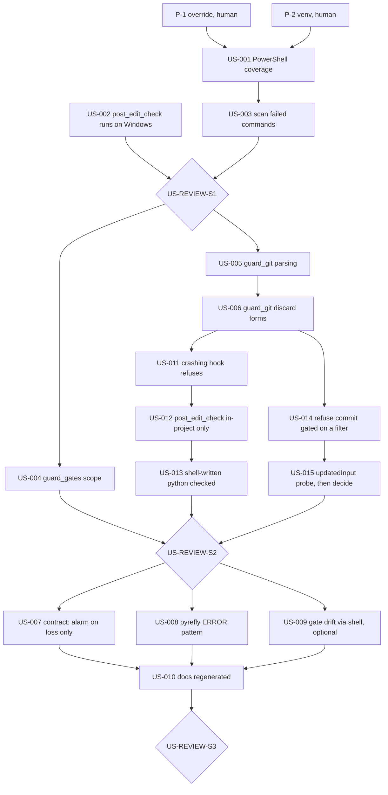

# PRD: Harness Hardening

## Introduction

The probes on 2026-10-09 found that the CI gates hold, but several in-turn hooks do not.
On this Windows machine the in-turn layer that `docs/GUARDRAILS.md` describes is partly not running,
and partly has holes. Every finding below came from a command that was run, and each is restated as
an acceptance criterion. The probe scripts and their BEFORE output are in
`docs/evidence/harness_probes_2026-10-09.md`; copy a script out of it to re-run a matrix.

### Baseline (VERIFIED, 2026-10-09, scratch venv, Python 3.14.3)

| Gate | Command | Result |
| --- | --- | --- |
| ruff | `ruff check .` | All checks passed |
| types | `python -m tools.check_types` (with `VIRTUAL_ENV` set) | 0 diagnostics (4 suppressed); hooks 0 |
| check_fp | `python -m tools.check_fp` | 0 finding(s) |
| pytest | `pytest -q` | 215 passed |
| mutation | `python -m tools.mutation_check` | 21 of 21 killed, canary survived |
| RED audit | `check_red --base 2b68ad6^ --head 2b68ad6` | 37 of 37 RED |

### Findings this PRD fixes (VERIFIED by probe unless marked)

| ID | Finding | Evidence |
| --- | --- | --- |
| F1 | The `PowerShell` tool bypasses every shell hook: matchers say `Bash` only. | `git add -A --dry-run` denied in Bash, exit 0 in PowerShell; `WARN`/`Traceback` lines from PowerShell not scanned |
| F2 | `post_edit_check` cannot start on Windows: wired to `.venv/bin/python`; no `.venv` exists, and on Windows it would be `.venv/Scripts/python.exe`. | wired command: `exit=127 ... No such file or directory` |
| F3 | With a venv, `post_edit_check` and `check_types` report false `missing-import` ERRORs, because pyrefly queries the first Python on PATH, not `sys.executable`. | `post_edit_check` on clean `app/services.py`: exit 2, 3 bogus ERRORs; with `--python-interpreter-path <sys.executable>`: `0 errors` |
| F4 | `diagnostic_scan` never sees a failed command: a non-zero exit does not fire `PostToolUse`. The docs (as relayed) say it fires both; the live trace says it does not. | `.fired.log`: exit 0 command logged, exit 3 command not logged |
| F5 | `guard_git` misses discard and stage-all forms, and has one false positive. | 17 of 29 (round 1) and 9 of 20 (round 2) probe cases mismatched; the table is in US-005/US-006 |
| F6 | `guard_gates` misses gate files, case variants and NotebookEdit. | 11 of 20 probe paths mismatched; the table is in US-004 |
| F7 | `diagnostic_scan`'s payload-contract check raises a false "SHAPE MOVED" alarm whenever the harness adds a key. | 6 false alarms in one session: `persistedOutputPath`, `persistedOutputSize`, `backgroundTaskId`, `backgroundCwdHint`, `bashEditDiff`, `returnCodeInterpretation` (seen when a command exits non-zero but is still reported as success, e.g. `grep -c` finding 0) |
| F8 | `diagnostic_scan` matches pyrefly `WARN` but not pyrefly `ERROR`. | 40+ `ERROR ...` lines in one output, 0 hits |
| F9 | The docs are stale: 17 mutants and 174 tests stated; 21 and 215 now. The guard commit says 35 tests; it added 37. | `mutation_check`, `pytest -q`, `check_red` outputs above |

### Not findings: measured and good, keep as is

- Precision of `diagnostic_scan` patterns on green gate output: **0 hits** on pytest -v (226 lines), ruff, check_fp, check_types, complexity, git log.
- `cat` of source trips the scanner in **3 of 48** files, all of which are about diagnostics. Accepted; do not add read-only-command suppression.
- PreToolUse `deny` is enforced under `--dangerously-skip-permissions` (documented). The ralph loop is therefore still governed by `guard_gates`.

## Goals

1. Every shell route an agent has (Bash, PowerShell) is judged by the same shell hooks.
2. The in-turn type/lint check runs on Windows and on POSIX, and is silent on a clean file.
3. Failed commands are scanned for diagnostics, not only successful ones.
4. `guard_git` and `guard_gates` refuse every case in their probe tables, and stay quiet on every allowed case.
5. Each fix is LOCKed: a test that was RED first, plus a mutant the suite kills.
6. The docs' numbers are regenerated from commands, not edited by hand.

## Contract (per the global engineering standards)

- **Oracle:** the probe tables in each task, written before the code as parametrized tests. Each new test must be RED on `main` (`check_red`), and each fix gets a mutant (`mutation_check`). For the live-only behaviours (F1, F4), the oracle is a recorded live firing, never the documentation.
- **Scope boundary (NOT in this change):** app code; CI workflow structure; porting `check_claims`/`check_discipline` from ssi; a full shell parser; protecting `tests/` from the agent; Bash-route writes to gate files (detected by an optional task, never blocked).
- **Failure mode:** a hook that crashes, or matches too broadly. A PreToolUse crash is non-blocking, so it fails open. A false deny stalls the agent, and a person notices the deny reason in the transcript. Every hook keeps its exit-0 contract, and the allowed-case tables exist to catch over-matching.
- **Rollback:** each task is one commit on branch `harness-hardening`. Revert that commit. Gate files return to `main` with `git checkout main -- <path>` (run by a person).

## The gate-edit problem (decision required before the loop)

Most fixes edit gate files (`.claude/hooks/*`, `.claude/settings.json`, `tools/mutation_check.py`).
`guard_gates` refuses those edits by design, also under `--dangerously-skip-permissions`.
The route around it, writing the files through Bash, is the exact bypass this PRD documents, so the loop must not use it.

| Option | How | Cost |
| --- | --- | --- |
| **A. Launch-time override (recommended)** | P-1: a person adds to `guard_gates` that, when the hook process env has `GATE_EDIT=1`, gate edits are allowed and each one is announced through `additionalContext`. A person launches the loop with `GATE_EDIT=1 ./ralph.sh ...`. Hooks inherit Claude Code's process env, and a variable exported inside a Bash tool call does not reach later hooks (documented). The `env` key in `settings.local.json` is closed by gating that file in P-1. | One human patch. Inside the loop, gates are writable; the backstops are RED-first, the mutants and human review of the branch diff. |
| B. Patch-out | The loop writes RED tests plus `patches/US-xxx.diff` for gate files. A person runs `git apply` between iterations. | No unattended loop; one manual step per task. |
| C. Disable hooks for the loop | — | Rejected: the loop would run with none of the guards it is fixing. |

## Prerequisites (a person, before the loop; not loop tasks)

**P-1 (Option A only) Gate-edit override and `settings.local.json`.** A person applies this to `.claude/hooks/guard_gates.py`:
- Add `(".claude", "settings.local.json")` to `GATES`.
- In `main()`, after a refusal has been decided: if `os.environ.get("GATE_EDIT") == "1"`, print an allow with `additionalContext`: `"gate edit to <path> allowed by GATE_EDIT=1 set at launch"`. Otherwise deny as today.
- Add a test to `tests/integration/test_hooks.py`: the override env allows a gate edit, absent env denies, and `GATE_EDIT=0` denies.

**P-2 Environment.**
```bash
python -m venv .venv
.venv/Scripts/python -m pip install -e ".[dev]"     # POSIX: .venv/bin/python
```
`python3` must start Python 3.11+ (R1-1). Every hook launches with it, and on a stock Windows
install `python3` is the Microsoft Store stub, so the guards would fail open. A SessionStart
check says so loudly when it does not.
Run the baseline gates. Every one must match the Baseline table before US-001 starts.

### How to run

```bash
GATE_EDIT=1 ./ralph.sh harness_hardening 20 2 sonnet     # from the repo root, on branch harness-hardening
```
`ralph.sh` lives in `C:/dev/libesrm0/libesrm0/`; copy it or call it by path. It reads `PRD_HARNESS_HARDENING.md` and `progress_harness_hardening.txt`.

**In-session alternative:** the same tasks, run in order by the assistant in a Claude Code session started with `GATE_EDIT=1`. Without that, every gate edit is shown as a diff and needs a person's approval.

## Task Summary

- **Total:** 21 build tasks + 5 review gates = 26 (US-011 to US-015 added 2026-10-09 from the transcript audit; Sprint 4, US-016 to US-019 and its review, added 2026-10-10; Sprint 6, US-022, US-023 and its review, added 2026-10-10 from PR 5)
- **Progress:** 25/26 closed: 19 build tasks built, US-009 skipped by decision, 5 reviews passed or recorded; US-015 partial (Step 3 done, Steps 1-2 blocked on a person)
- **Status:** Sprint 6 DONE 2026-10-10 (US-022 a9058d3, US-023 26de8e0, review passed: 57 of 57 mutants); open issues in "Open review issues" at the end of this file
- **Next Task:** none for the agent. Person-only items: US-020, US-021, H-1 (review the gates, read PR 5's CI); see Sprint 5

## Task Dependencies



## Rules for every task

- **RED first.** Write the test, run it, and paste the failing output into the progress file. Only then change code. `python -m tools.check_red --base main` must pass before the task is marked `[x]`.
- **Portable RED.** CI runs on Linux. A Windows behaviour is tested through a pure function with an explicit input (e.g. `os_name="nt"`), never by depending on the host OS, so the test is RED on `main` on Linux too.
- **LOCK.** Every fix adds a `Mutant` to `tools/mutation_check.py` that reverts the essence of the fix. `python -m tools.mutation_check` must say `N of N mutants killed`.
- **Full gate run before `[x]`:** `ruff check .`, `python -m tools.check_types`, `python -m tools.check_fp`, `pytest -q`, `python -m tools.check_red --base main`, `python -m tools.mutation_check`. Paste the summary lines.
- **Never** write a gate file through Bash or PowerShell (`>`, `sed -i`, `Set-Content`, a Python one-liner). If the Edit tool is refused, stop and record it in the progress file.
- **Never** `git add -A` / `.`: stage named paths.
- Hooks keep their exit contract. PreToolUse exits 0 and decides through JSON. `diagnostic_scan` never blocks.

---

## Sprint 1: Make the hooks actually run (~45 min)
**Status:** COMPLETE (review: 1 issue, R1-1, see progress file)

- [x] **US-001** Shell hooks cover PowerShell (~15 min, ~60 lines) [depends: P-1, P-2]
- [x] **US-002** post_edit_check runs on Windows and POSIX, and is silent on a clean file (~20 min, ~80 lines) [depends: P-2]
- [x] **US-003** diagnostic_scan also scans failed commands (~15 min, ~70 lines) [depends: US-001]
- [x] **US-REVIEW-S1** Sprint 1 Review 🚧 GATE (~5 min) [depends: US-002, US-003]

### US-001: Shell hooks cover PowerShell (~15 min, ~60 lines)

**Implementation:**
- `.claude/settings.json`: change the `guard_git` PreToolUse matcher and the `diagnostic_scan` PostToolUse matcher from `Bash` to `Bash|PowerShell`. A matcher made only of letters and `|` is an exact-list match, per the hooks docs.
- `guard_gates` PreToolUse matcher: `Write|Edit|MultiEdit|NotebookEdit`. In `guard_gates.main()`, accept `NotebookEdit` and read `tool_input.notebook_path` when `file_path` is absent.
- New test `tests/integration/test_settings.py`:
  - Load `.claude/settings.json`. For each hook whose script is `guard_git.py` or `diagnostic_scan.py`, the matcher split on `|` must contain both `Bash` and `PowerShell`.
  - For `guard_gates.py`, it must contain `NotebookEdit`.
- Add to `tests/integration/test_hooks.py`: a `PowerShell` payload `{"tool_name":"PowerShell","tool_input":{"command":"git add -A"}}` is denied by `guard_git`, and a `NotebookEdit` payload on `.claude/hooks/x.ipynb` is denied by `guard_gates`.
- Mutants: `shell-hooks-skip-powershell` (`"Bash|PowerShell"` → `"Bash"`, first occurrence) and `gate-hook-skips-notebooks`.

**Do NOT:** change what `guard_git` judges; that is US-005/US-006.

**Acceptance Criteria:**
- `pytest tests/integration/test_settings.py -q` was RED on `main` (pasted), green now.
- **Live:** in a new session, the PowerShell tool runs `git add -A --dry-run` and the call is denied with the `guard_git` reason. `Write-Output "WARN live-probe"` returns `additionalContext` naming `a tool logged a warning`. Paste both.
- **Live:** with `.claude/hooks/.fired.log` touched, one PowerShell call logs `fired tool=PowerShell`. Record the PowerShell `tool_input` keys seen in the progress file. Delete the log after.
- Mutation check: all killed.

### US-002: post_edit_check runs on Windows and POSIX, silent on a clean file (~20 min, ~80 lines)

**Implementation:**
- `.claude/settings.json`: the PostToolUse edit hook command becomes `python3 "$CLAUDE_PROJECT_DIR/.claude/hooks/post_edit_check.py"`, the same launcher as the other hooks.
- `post_edit_check.py`:
  - Add a pure `venv_python(root: Path, os_name: str) -> Path`. It returns `root/.venv/Scripts/python.exe` when `os_name == "nt"`, else `root/.venv/bin/python`.
  - `_run` uses that interpreter instead of `sys.executable`.
  - If the interpreter does not exist, exit 2 with: `in-turn checks are NOT running: no venv at <path>. Create it (PRD P-2).` The agent must see that the layer is off, not get silence.
- Pass `--python-interpreter-path <venv python>` to pyrefly in `post_edit_check`. Pass `--python-interpreter-path sys.executable` in `tools/check_types.py`'s `PYREFLY` tuple.
- Tests in `tests/integration/test_hooks.py`:
  - `venv_python(Path("r"), "nt")` and `venv_python(Path("r"), "posix")` return the two paths.
  - `findings()` on clean `app/services.py`, run in a subprocess whose env has `VIRTUAL_ENV` removed and `PATH` set to an empty temp dir, returns `[]`. On `main` this returns `missing-import` ERRORs (or ruff cannot run). Confirm it is RED on `main` and paste the output.
  - With no venv, the hook exits 2 and names the path.
- Mutants: `post-edit-drops-interpreter-path` and `check-types-drops-interpreter-path`.

**Acceptance Criteria:**
- The clean-file test is RED on `main`, green now. If it is not RED on `main` on Linux, stop and record why: the oracle is wrong.
- **Live:** edit a scratch `.py` file in the repo with a deliberate `x: int = "s"`. The `post_edit_check` finding comes back in the same turn. Then fix the file and see no finding.
- `python -m tools.check_types` passes with `VIRTUAL_ENV` unset.
- Mutation check: all killed.

### US-003: diagnostic_scan also scans failed commands (~15 min, ~70 lines)

**Implementation:**
- **Step 1, record before you code:** register `diagnostic_scan.py` under `PostToolUseFailure` with matcher `Bash|PowerShell` in `settings.json`. Run one failing command (`echo "WARN x"; exit 3`). With `.fired.log` armed, have the hook dump the payload's key names (never values) into `.claude/hooks/payload_contract_failure.json`, the same way `record_contract` does.
- Step 2: `extract_output()` reads whatever field that recorded payload actually carries the output in. The docs say `error`; trust the recording. Tests are built from the recorded shape, as `test_diagnostic_scan.py` already does for the success payload.
- `render()` says `the command FAILED (exit n)` when the event is `PostToolUseFailure`.
- Mutant: `scan-ignores-failed-commands` (the failure-field read removed).

**Acceptance Criteria:**
- **Live:** `echo "WARN live"; exit 3` in Bash and `Write-Output "WARN live"; exit 3` in PowerShell both return `additionalContext` naming the WARN line. Paste both.
- Tests built from `payload_contract_failure.json` were RED on `main`.
- Mutation check: all killed.

### US-REVIEW-S1: Sprint 1 Review 🚧 GATE (~5 min)

**Scope:** US-001 to US-003
**Review Steps:**
1. Full gate run (see Rules), pasted.
2. Re-run `probe_scan` (precision): 0 hits on green gate output. A new event or matcher must not add noise.
3. Read `settings.json`: every hook entry names an interpreter that exists on both OSes.

**Gate:** Output `<review-passed/>` or `<review-issues-found/>` with a list. Commit `"docs: US-REVIEW-S1 complete"`.

---

## Sprint 2: Make the guards judge the right things (~60 min)
**Status:** COMPLETE except US-015 Steps 1-2 (review: 4 issues, R2-1..R2-4, see progress file)

- [x] **US-004** guard_gates: missing gates, case variants (~15 min, ~50 lines) [depends: US-REVIEW-S1]
- [x] **US-005** guard_git: find git inside wrappers, global options, PowerShell syntax (~25 min, ~120 lines) [depends: US-REVIEW-S1]
- [x] **US-006** guard_git: every discard form, cwd drift, aliases, `--staged` false positive (~25 min, ~120 lines) [depends: US-005]
- [x] **US-011** A crashing PreToolUse hook refuses, not allows (~20 min, ~60 lines) [depends: US-006]
- [x] **US-012** post_edit_check judges only files inside the project (~10 min, ~30 lines) [depends: US-011]
- [x] **US-013** Python files written through a shell are checked too (~25 min, ~90 lines) [depends: US-012]
- [x] **US-014** Refuse a commit gated on a filter's exit status (~20 min, ~80 lines) [depends: US-006]
- [ ] **US-015** (Step 3 done; Steps 1-2 BLOCKED on a person, see progress) Probe updatedInput, then decide how truncated output is handled (~30 min) [depends: US-014]
- [x] **US-REVIEW-S2** Sprint 2 Review 🚧 GATE (~5 min) [depends: US-004, US-006, US-011, US-012, US-013, US-014, US-015]

### US-004: guard_gates scope (~15 min, ~50 lines)

**Probe table → parametrized test (`edit_allowed(path)`):**

| Path | Want |
| --- | --- |
| `.claude/settings.local.json` | deny (already done in P-1; keep the test) |
| `tools/check_red.py`, `tools/check_fp.py`, `tools/check_types.py`, `tools/isolation.py` | deny |
| `tests/conftest.py` (it enforces the control-test reason) | deny |
| `pyproject.toml` (pytest config: `testpaths`, `addopts`) | deny |
| `.Claude/Hooks/guard_git.py`, `RUFF.TOML`, `Tools/Mutation_Check.py` | deny |
| `app/services.py`, `tests/unit/test_rules.py`, `tests/spec.py` | allow |

**Implementation:**
- Add the entries to `GATES`.
- Match on `casefold()`ed parts. On Linux this also refuses a new file named `RUFF.TOML`; that is accepted.
- Mutants: `gates-case-sensitive` and `gates-forget-check-red`.

**Decision recorded:** `tests/spec.py` stays editable. Tests are the agent's job, and a spec change shows in review. Revisit if a person says otherwise.

**Acceptance Criteria:** every row passes; the allow rows were already green on `main`, the deny rows RED; mutation check all killed.

### US-005: guard_git parsing (~25 min, ~120 lines)

**Probe table → parametrized test (driven through `run_hook("guard_git", ...)` against a temp repo with a dirty file, as `probe_git.py` did):**

| Command | Want |
| --- | --- |
| `git -C . add -A`, `git -c core.x=1 add -A`, `git --no-pager add -A` | deny |
| `git.exe add -A` | deny |
| `git add -Av`, `git add -uv` | deny |
| `git add :/`, `git add -- :/`, `git add ':(top)'` | deny |
| `bash -c "git add -A"`, `sh -c 'git checkout -- f.txt'` (f.txt dirty) | deny |
| `env git add -A`, `& git add -A`, `cmd /c git add -A` | deny |
| `pwsh -Command "git add -A"`, `powershell -c "git add -A"` | deny |
| ``git add ` (newline) -A`` (PowerShell continuation) | deny |
| `$(git add -A)` | deny |
| `git commit -m 'mention git add -A here'`, `grep -E "a\|b" f.txt` | allow |
| `git status`, `git checkout main`, `git add f.txt`, `git log -- .`, `git diff -- sub` | allow |

**Implementation:**
- `words()` normalises `git.exe` → `git`, and skips git's global options (`-C <x>`, `-c <x>`, `--git-dir=…`, `--work-tree=…`, `--no-pager`, `-P`, `--paginate`) to find the subcommand.
- Unwrap known prefixes: `env [VAR=x…]`, `&`, `command`, `exec`, `cmd /c`.
- For `bash|sh|pwsh|powershell -c|-Command "<s>"`, judge `<s>` recursively.
- Treat `$( … )` bodies as commands.
- In `guard_shared.commands()`, join PowerShell backtick-newline continuations before splitting.
- In `check_add`: deny any short-flag cluster containing `A` or `u`, and any pathspec that starts with `:/` or `:(top`.
- **Stated limit, in the docstring:** `eval`, scripts, `Start-Process git -ArgumentList …` and aliases defined outside the repo are not parsed. Note that `Start-Process` was allowed in the probe.
- Mutants: `git-hook-ignores-global-options` and `git-hook-ignores-nested-shell`.

**Acceptance Criteria:** every row passes; every allow row stays allowed; mutation check all killed.

### US-006: guard_git discard forms (~25 min, ~120 lines)

**Probe table** (temp repo; `sub/x.txt` dirty unless stated):

| Command | Want |
| --- | --- |
| `git checkout sub/x.txt`, `git checkout .`, `git checkout HEAD sub/x.txt` (no `--`) | deny |
| `git checkout -f`, `git checkout --force main`, `git switch --discard-changes main`, `git switch -f main` | deny |
| `git reset --hard`, `git reset --hard HEAD~1` | deny |
| `git clean -fd`, `git clean -fdx` (with an untracked file present) | deny |
| `git stash drop`, `git stash clear` | deny |
| `cd sub && git checkout -- x.txt`, `cd sub && git restore x.txt` | deny (judged in `sub`) |
| `git aa` where repo config has `alias.aa = add -A` | deny |
| `git restore --staged sub/x.txt` | **allow** (index only; today a false deny) |
| `git checkout main`, `git checkout -b new`, `git switch main` (clean tree) | allow |
| `git reset --hard` / `git clean -fd` on a clean tree with no untracked files | allow |
| `git checkout -- f.txt` where f.txt is clean | allow |

**Implementation:**
- `checkout` without `--`: after options, an argument that exists as a path in the effective cwd (or is `.`) puts the command in path mode. When the first argument verifies as a ref (`git rev-parse --verify --quiet`) and later arguments are paths, that is path mode too.
- Force forms (`checkout -f/--force`, `switch --discard-changes/-f`, `reset --hard`, `stash drop/clear`): deny when `git status --porcelain` is non-empty.
- `clean -f…`: deny when `git status --porcelain --untracked-files=all` lists `??` entries.
- Fail closed, as today, when `git status` cannot run.
- `restore --staged` without `--worktree`/`-W`: allow.
- Track `cd <dir>` across a compound line: a `cd` command updates the cwd used for later commands in the same line.
- Expand a repo-local alias once: `git config --get alias.<name>`.
- Mutants: `git-hook-allows-checkout-without-dashdash` and `git-hook-allows-reset-hard`.

**Acceptance Criteria:** every row passes; the false-positive row was RED on `main`; mutation check all killed.

### US-011: A crashing PreToolUse hook refuses, not allows (~20 min, ~60 lines)

**Found by:** the transcript audit of this run, 2026-10-09. From call #149 to #154 (about 18 s), `guard_shared.py` referenced an undefined name, `_without_heredocs`, while US-005 was being edited. Every hook that imports it would crash. A crashing PreToolUse hook exits 1, which Claude Code treats as a non-blocking error, so the tool call goes ahead and `guard_git` was effectively off. Hooks run from the working tree, so any half-finished hook edit opens this window.

**Implementation:**
- `guard_git.py` and `guard_gates.py`:
  - Wrap the `import guard_shared` line in `try/except Exception` and keep the exception.
  - Wrap `main()`'s body in `try/except Exception`.
  - On either failure, print a PreToolUse **deny** whose reason names the hook, the exception type and its message, e.g. `guard_git crashed (NameError: ...): refusing rather than guessing. Fix the hook through Edit.`
  - Print that deny with `json.dumps` inline, never through `guard_shared.deny`, because the import may be the thing that failed.
- **Deadlock check, the reason this is safe here:**
  - A crashed `guard_git` blocks shell calls only. The fix goes through Edit, which `guard_git` does not judge.
  - A crashed `guard_gates` blocks Write/Edit. Without `GATE_EDIT=1` the agent may not edit hooks anyway, so a person fixes it.
  - With `GATE_EDIT=1`, `guard_gates` must **fail open but say so**: an `additionalContext` naming the crash, as the override announce does. Otherwise the agent could not repair the hook it just broke. That is the ssi `guard_tdd` deadlock (FINDINGS_HARNESS_REVIEW).
- `diagnostic_scan.py` and `post_edit_check.py` report and never block, so they keep their exit contract.
- Tests in `tests/integration/test_hooks.py`:
  - Copy `.claude/hooks` to `tmp_path`, write a `guard_shared.py` that raises `NameError` at call time, and run the copied `guard_git` on `git status`. Expect a deny that names `NameError`.
  - Same with a `guard_shared.py` containing a syntax error (import-time failure). Expect a deny.
  - `guard_gates` with a broken `guard_shared`: deny without `GATE_EDIT`; with `GATE_EDIT=1`, no deny and `additionalContext` naming the crash.
  - All of these are RED on the base, where the copied hook exits 1 and prints nothing.
- Mutants: `git-hook-crash-fails-open` (the `except` removed from `guard_git.main`) and `gate-hook-crash-blocks-override` (the `GATE_EDIT` branch removed from the crash path).

**Acceptance Criteria:**
- Every test above was RED on the base, pasted.
- `check_red --base main` passes.
- The mutation check kills everything.
- **Live, in a scratch copy only:** never break the live hooks to test this.

### US-012: post_edit_check judges only files inside the project (~10 min, ~30 lines)

**Found by:** the same audit. The hook linted a scratchpad script outside the repo against the repo's ruff config. It reported B007 style noise along with real findings, on a file nobody asked it to judge.

**Implementation:**
- In `findings()`, return `[]` when `root` is not in `path.resolve().parents`.
  - The pyrefly branch already has this guard. Ruff does not.
- The existing tests `test_post_edit_check_reports_a_ruff_finding_in_the_edited_file` and `test_post_edit_check_is_silent_on_a_clean_file` write to `tmp_path` and pass `ROOT`. Change them to pass `tmp_path` as the root, so the file is inside the project they name.
  - This changes existing tests. Say so in the commit message.
- New test: a `.py` file with an ARG001 finding in `tmp_path`, judged with `root=ROOT`. Expect `[]`. RED on the base.
- Mutant: `post-edit-judges-outside-files` (the root guard removed).

**Acceptance Criteria:** the new test was RED on the base; the changed tests pass; the mutation check kills everything.

### US-013: Python files written through a shell are checked too (~25 min, ~90 lines)

**Found by:** the same audit, plus US-002's own gate run. `tests/integration/test_check_types.py` was edited by a Bash `python - <<'EOF'` script (#49), so `post_edit_check` never saw it. An unused `import os` (F401) got through the turn and was caught only by `ruff check .` in the full gate run. The `heredoc_backslash` warning fired on that command, but nothing said the in-turn lint had been skipped.

**Implementation:**
- In `diagnostic_scan.py`, add a pure function `recently_written(root: Path, since: float) -> list[Path]`. It returns the `.py` files under `root` (excluding `.git`, `.venv`, `__pycache__`) whose mtime is at or after `since`.
- In `main()`, for `Bash|PowerShell` PostToolUse **and** PostToolUseFailure:
  - Compute `since = now - duration_ms/1000 - 2`. `duration_ms` is in the recorded payload contract.
  - If any `.py` files changed, call `post_edit_check.findings()` on each, importing the sibling the way the guards import `guard_shared`, with the venv interpreter from `post_edit_check.venv_python`.
  - Report through `additionalContext`, headed `Python files written through a shell (post_edit_check did not see these):`.
  - Skip silently when the venv is missing; `post_edit_check` already says so loudly.
- Cost limit: the mtime walk must take under 200 ms on this repo; measure it and paste the number. The checks run only when files changed.
- **Precision:**
  - A command that writes no `.py` file reports nothing.
  - `pytest` writes only `.pyc` files and temp dirs outside the repo, so it reports nothing. Test this with the real suite command.
- Tests:
  - `recently_written` on a tmp tree with one old and one new file returns only the new one.
  - A payload whose `cwd` is a tmp project with a fresh `bad.py` (`def f(unused): return 1`) and `duration_ms=500` gets `additionalContext` naming ARG001.
  - A payload with no fresh file gets none.
  - All RED on the base.
- Mutant: `shell-written-python-unchecked` (the `recently_written` call removed from `main`).

**Acceptance Criteria:**
- Tests RED on the base; the mutation check kills everything.
- **Live:** `printf 'import os\n' > scratch_shell_probe.py` in Bash returns `additionalContext` naming F401 for that file. Delete the file after.
- **Live:** `pytest -q` returns no such context.

### US-014: Refuse a commit gated on a filter's exit status (~20 min, ~80 lines)

**Found by:** the transcript audit. Call #10 ran `pytest … 2>&1 | tail -2 && git add … && git commit`. A pipeline's exit status is its last stage's, so `&&` saw `tail`'s 0, and a failing suite would still have committed. Demonstrated: without `pipefail` the chain continued after exit 1; with `set -o pipefail` it stopped. `pipefail` was never set in 97 shell calls. The existing `stderr_merged_then_truncated` warning fired on that call and changed nothing (0 of 7 warned uses changed). A refusal cannot be read past; a warning can.

**Probe table → parametrized test** (through `run_hook("guard_git", ...)`; Bash and PowerShell payloads):

| Command | Want |
| --- | --- |
| `pytest -q 2>&1 \| tail -2 && git commit -m x` | deny |
| `pytest -q \| grep -E "passed\|failed" && git add a.py && git commit -m x` | deny |
| `ruff check . \| head -5 && git push` | deny |
| `python -m tools.check_red --base main \| tail -1 && git commit -m x` | deny |
| `set -o pipefail; pytest -q \| tail -2 && git commit -m x` | allow |
| `pytest -q && git commit -m x` | allow |
| `git log \| head -5 && git status` (no commit/push) | allow |
| `pytest -q \| tail -2; git status` | allow |
| `git commit -m "a \| tail && git commit"` (all quoted) | allow |
| `cat >> notes.txt <<'EOF'` with a body containing `x \| tail && git commit` | allow |

**Implementation:**
- In `guard_git`, judge each statement (split on `;` and newline, with quotes and heredocs respected, through `guard_shared`) as a chain of `&&` segments.
- Deny when an earlier segment has an unquoted pipe whose last stage is a filter (`tail`, `head`, `grep`, `sort`, `Select-String`, `Select-Object`, `findstr`), a later segment is `git commit` or `git push`, and `set -o pipefail` does not appear earlier in the line.
- Deny reason: `this commit is gated on <filter>'s exit status, not on <first command>'s. A failing run would still commit. Add 'set -o pipefail;' or run the check and the commit as separate commands.`
- Mutant: `commit-gated-on-filter-allowed`.

**Acceptance Criteria:**
- Deny rows RED on `main`; allow rows green there and marked `@control` with a reason.
- **Live:** in Bash, `true | tail -1 && git commit --dry-run -m probe` is denied. `--dry-run` writes nothing.
- The mutation check kills everything.

### US-015: Probe `updatedInput`, then decide how truncated output is handled (~30 min; build only if the probe allows)

**Found by:** the same audit. 24 of 97 shell calls threw output away: 7 with `2>&1 | tail/head`, which the hazard check flags, and 17 with `2>&1 | grep`, which it never sees. The warning changed behaviour 0 times. Whether anything was actually lost is unknown: on green runs the gate outputs carry no diagnostics. Instead of asking the agent to stop truncating, make truncation harmless. A PreToolUse hook can rewrite a command (`updatedInput`, documented). The details that decide whether that is safe are **not documented**.

**Step 1, SPIKE: record before building.** Register a throwaway PreToolUse hook on Bash. It rewrites only the exact command `echo PROBE-ORIGINAL` to `echo PROBE-REWRITTEN`. Run it in three variants:
- (a) `updatedInput` with no `permissionDecision`;
- (b) with `"ask"`;
- (c) with `"allow"`.

For each variant, record in `docs/evidence/updated_input_probe.md`, with the pasted output:
1. Which string ran.
2. Whether the permission prompt still appears in default mode.
3. What the agent's transcript shows: the original or the rewritten command.
4. The same under `claude -p`.

Remove the throwaway hook afterwards.

**Decision rule (mechanical):** build Step 2 **only if** a rewrite applies without `"allow"`. With `"allow"` the rewrite would skip the permission prompt for every rewritten command in normal mode, which is worse than the problem it fixes. Otherwise mark this task `[x] DECIDED: not built`, link the evidence, and do Step 3 only.

**Step 2 (only if allowed): the tee rewrite.**
- New PreToolUse hook `truncation_log.py` on `Bash`. For a command where `2>&1` feeds a filter (`tail`, `head`, `grep`), rewrite it to `set -o pipefail; <producer> 2>&1 | tee "<log>" | <filter…>`.
  - `<log>` is `.claude/hooks/.truncated/<tool_use_id>.log`, gitignored.
- `diagnostic_scan` (PostToolUse and PostToolUseFailure) reads that log when it exists. It scans only lines **not** in the visible output, reports hits as `diagnostics the filter discarded:`, stays silent when there are none, and deletes the log.
- `pipefail` makes a failing producer fail the call, so PostToolUseFailure fires and the agent sees the real exit status.
- Per the docs, only one hook may rewrite a tool's input (the last to finish wins, nondeterministically). `test_settings.py` asserts that only `truncation_log.py` returns `updatedInput`.
- Tests:
  - the rewrite function on a table of commands;
  - a discarded `WARN` line is reported;
  - a green run reports nothing.
- Mutant: `truncation-log-not-scanned`.

**Step 3 (either way): the existing warning.**
- If Step 2 was built, remove `stderr_merged_then_truncated` from `COMMAND_HAZARDS`; the log makes it redundant.
- If not, remove it too, and record why in `docs/CHECKS.md`: 7 warned uses, 0 behaviour changes, 17 undetected `| grep` uses. US-014 now holds the part that mattered.
- Update its tests and mutants with it. A check that is measured not to work and keeps firing teaches the reader to ignore hooks.

**Acceptance Criteria:**
- The probe evidence file exists, with all four questions answered for all three variants.
- The decision is recorded in `progress_harness_hardening.txt`.
- If Step 2 was built: **live**, `python -c "import sys; print('WARN hidden', file=sys.stderr); print('ok')" 2>&1 | tail -1` reports `WARN hidden` as discarded.
- The mutation check kills everything.

### US-REVIEW-S2: Sprint 2 Review 🚧 GATE (~5 min)

**Scope:** US-004 to US-006, and US-011 to US-015
**Review Steps:**
1. Full gate run, pasted.
2. Re-run both `guard_git` probe matrices and the `guard_gates` matrix: 0 mismatches. Paste the output.
3. Linus check: is `guard_git` still readable top to bottom? If it is over ~250 lines, split the parsing into `guard_shared`.

**Gate:** `<review-passed/>` or `<review-issues-found/>`. Commit `"docs: US-REVIEW-S2 complete"`.

---

## Sprint 3: Noise, recall, and the record (~50 min)
**Status:** COMPLETE (review: R3-1 fixed; R3-2 recorded, see progress and evidence)

- [x] **US-007** Payload contract alarms only on loss (~10 min, ~40 lines) [depends: US-REVIEW-S2]
- [x] **US-008** diagnostic_scan sees pyrefly ERROR lines (~10 min, ~20 lines) [depends: US-REVIEW-S2]
- [x] SKIPPED (decided 2026-10-09) **US-009** (OPTIONAL, needs a person's yes) Report gate files changed through a shell (~20 min, ~80 lines) [depends: US-REVIEW-S2]
- [x] **US-010** Regenerate doc numbers; record the probes (~15 min, docs) [depends: US-007, US-008, US-009]
- [x] **US-REVIEW-S3** Final Review 🚧 GATE (~5 min) [depends: US-010]

### US-007: Contract alarms only on loss (~10 min, ~40 lines)

**Implementation:**
- `check_contract()` reports when a pinned top-level key or a pinned `tool_response` key is **gone**, or when `tool_response` stops being a dict.
- Added keys are not reported. They were the only alarms seen live, and all of them were benign.
- Tests are parametrized over the live extra-key sets from F7 (four distinct sets plus `returnCodeInterpretation`), each of which must give `[]`. A payload with `stdout` removed must still alarm.
- **Amended 2026-10-09 (found in US-001):** PowerShell's `tool_response` has no `noOutputExpected`. That is a key *loss*, so "alarm on loss only" would still fire on every PowerShell call. Pin the contract per `tool_name`, or treat `noOutputExpected` as optional. A PowerShell payload without it must give `[]`.
- Mutant: `contract-alarms-on-added-keys`.

**Acceptance Criteria:** RED on `main` for every extra-key case; mutation check all killed. **Live:** a large-output command and a background command produce no contract note.

### US-008: pyrefly ERROR lines (~10 min, ~20 lines)

**Implementation:**
- Add the pattern `(r"(?m)^\s*ERROR\b", "a tool logged an error")` next to the `WARN` one. Cite F8 in its comment.
- Test: the 3 bogus `ERROR Cannot find module ...` lines recorded in F3 produce hits.
- Precision test: the green outputs from the Baseline (pyrefly `INFO 0 errors`, pytest -v, ruff) produce 0 hits.
- Mutant: `scan-misses-pyrefly-error`.

**Acceptance Criteria:** both tests pass; the recall test was RED on `main`; mutation check all killed.

### US-009 (OPTIONAL): Report gate files changed through a shell (~20 min, ~80 lines)

Skip and mark `[x] SKIPPED (no decision)` unless a person has approved it in `progress_harness_hardening.txt`.

**Why optional:** this is detection, not prevention. In ssi, the general version (`guard_effects`) caught 0 defects. This version watches only the gate list, where one silent edit voids a gate.

**Implementation:**
- New PostToolUse hook `gate_drift.py` on `Bash|PowerShell`. It runs `git status --porcelain -- <GATES>`. If any gate path is modified in the worktree, it returns `additionalContext`: `a gate file changed through the shell: <paths>. A gate cannot check its own weakening; a person must review this.`
- It imports `GATES` from `guard_gates` so there is one list.
- It reports and never blocks; it must finish in under 1 s.
- Mutant: `gate-drift-silent`.

**Acceptance Criteria:**
- **Live:** `echo "# x" >> ruff.toml` in Bash produces the context. Then the person restores the file with `git checkout -- ruff.toml`; `guard_git` will refuse that, by design, so the person runs it outside the agent.
- Clean-tree commands produce nothing.

### US-010: Regenerate doc numbers; record the probes (~15 min, docs)

**Implementation:**
- `docs/CHECKS.md`:
  - Replace the mutation and pytest blocks with fresh pasted output.
  - Add instrument-defect rows 13+ for F1–F8, each with the probe command and output.
  - Correct "35 tests" to the measured count.
- `docs/GUARDRAILS.md`:
  - Fix the "injects 17 bugs" sentence.
  - Hook table: matchers include PowerShell; `post_edit_check` names its interpreter rule.
  - The limit paragraph names PowerShell, plus what is still not parsed.
- `docs/evidence/harness_probes_2026-10-09.md`: append an AFTER section, with each probe re-run and its output pasted. The BEFORE section already exists.

**Do NOT:** type any number by hand. Each number is pasted from a command that appears next to it.

**Acceptance Criteria:** `grep -n "17 bugs\|174 passed\|35 tests" docs/*.md` returns nothing stale; every number has its command alongside.

### US-REVIEW-S3: Final Review 🚧 GATE (~5 min)

**Review Steps:**
1. Full gate run, pasted.
2. All probe matrices: 0 mismatches.
3. Live: the US-001 and US-003 checks, re-run in a fresh session.
4. Fresh-reviewer angle: give the diff to a reviewer agent told to find a command that destroys uncommitted work, or edits a gate, without any hook noticing. Record each hit as a new probe row, or as a stated limit.

**Gate:** `<review-passed/>` or `<review-issues-found/>`. Commit `"docs: US-REVIEW-S3 complete"`.

---

## Non-Goals

- A real shell parser for Bash or PowerShell. The guards stay table-driven, with their limits stated.
- Blocking Bash/PowerShell writes to gate files. US-009 only reports them.
- Porting ssi's `check_claims.py`, `check_discipline.py`, `PROVEN_RED` or `unreachable.py`. See the brainstorm.
- Making `tests/` read-only to the agent.

## Brainstorm: considered, not in this PRD

| Idea | Why not now |
| --- | --- |
| Port `check_claims.py` (re-run fenced claim blocks in docs) | It would have caught F9 automatically. It is the next PRD, and it needs a decision on its allowlist. |
| PROVEN_RED per test module (ssi) | Overlaps `check_red` + mutants; in ssi it costs 60% of suite time. |
| Deny `git config alias.*` writes | Narrow; US-006 expands repo-local aliases instead. |
| Hash-pin hook files and verify at SessionStart | Same detection as US-009, but later and with more machinery. |
| Suppress scans of read-only commands (`cat`, `Get-Content`) | Measured 3 of 48 files; noise too small to justify a rule (precision first, patterns only after a miss). |
| Managed-settings hooks (the only scope a project file cannot disable) | Org-level policy, outside this repo. |
| Run the mutation check in the in-turn hook | ~2-3 min per run; CI is the right place. |

## Decisions (answered 2026-10-09)

1. Gate-edit mechanism: **Option A, launch-time `GATE_EDIT=1`.**
2. Execution: **in-session, task by task.** The session that runs US-001 onward must be launched with `GATE_EDIT=1` after a person applies P-1.
3. US-009 gate-drift reporter: **skip.** The loop marks it `[x] SKIPPED (decided 2026-10-09)`.
4. Gate `tests/spec.py`: **no.**

## Post-Build Verification

- [ ] Full gate run green locally (Windows) and in CI (Linux, both legs)
- [ ] Probe matrices: 0 mismatches
- [ ] Live: PowerShell `git add -A` denied; failed-command WARN surfaced; edit-time type error surfaced
- [ ] `mutation_check`: every mutant killed, including the ~14 new ones
- [ ] `check_red --base main`: every new test RED on `main`

---

## Open review issues (updated after Sprint 4, 8675216, 2026-10-10)

Each of the three sprint reviews ends in `<review-issues-found/>` (`progress_harness_hardening.txt`). Still open:

* US-015 Steps 1-2, blocked on a person: auto mode refused the edit that registers the throwaway `updatedInput` probe hook (R2-1).
* `guard_git.py` at 362 lines after Sprint 4, against a target of about 250 (R2-2; Decision 3: growth accepted).
* ~~The stale `.pyc` risk (R2-3)~~ FIXED by US-016: hooks and test helpers run with `-B`; no `__pycache__` is written.
* The ~30 bypasses the fresh reviewer found (R3-2): the cheap ones (abbreviated options, `-qf`, `git rm -f`, `..`) are FIXED by US-017 to US-019; the rest stay recorded limits ( `docs/evidence/harness_probes_2026-10-09.md`, section "US-REVIEW-S3: fresh-reviewer probe").
* The `python3` warning (R1-1) not yet seen firing on a machine without Python.
* CI not run, because the branch is not pushed.

## Follow-up Sprint 4: cheap rows and stale bytecode (DONE 2026-10-10, review passed)

**Why only these.** The post-session assessment found that the outcome gates (check_red, mutation, pytest, ruff) carry the
assurance, and that `guard_git`, a hand-rolled shell parser, cannot be closed row by row: the reviewer's own stated limits
need a real parser. This sprint takes only the fixes that are cheap and common, plus the one real hazard (R2-3).
Everything else in R3-2 stays a recorded limit.

**Contract.**
- **Oracle:** each task's table, written first as parametrized tests that are RED on `main` (and on `67718ee`); one
  mutant per fix. For US-016, the oracle is observable: no `.claude/hooks/__pycache__` exists after the suite and a live
  firing of each hook.
- **Scope boundary (NOT in this sprint):** the other ~25 R3-2 rows; Windows path forms in `guard_gates` (trailing dot
  or space, `::$DATA`, 8.3 names) unless Decision 1 says yes; adding files to the gate list (Decision 2); splitting
  `guard_git` (R2-2); mutation-check speed; app code.
- **Failure mode:** a false deny stalls the agent, and the deny reason names the rule. Each table has allow rows to catch
  over-matching. US-016's only cost is that hooks compile on every run; measure it.
- **Rollback:** one commit per task on `harness-hardening`; revert it.

**Rules:** as for Sprints 1-3. RED first; gate files edited only through Edit, in a session launched with
`GATE_EDIT=1`; full gates run on a clean worktree of each task's commit, with `GATE_EDIT` unset; check_red after the
commit; never `git add -A`.

- [x] **US-016** Hooks never run stale bytecode (R2-3) (~20 min, ~40 lines)
- [x] **US-017** guard_git: abbreviated long options and `-qf` clusters (~25 min, ~60 lines)
- [x] **US-018** guard_git: `git rm -f` over uncommitted work (~15 min, ~40 lines)
- [x] **US-019** guard_gates: collapse `..` before matching (~10 min, ~15 lines)
- [x] **US-REVIEW-S4** Sprint 4 Review 🚧 GATE (~10 min) [depends: US-016..US-019]

### US-016: Hooks never run stale bytecode (R2-3)

**Found by:** US-014. A same-length edit (`SEPARATORS` to `separators`) within one second left the source mtime and
size equal to the cached `.pyc`, so Python ran the old splitter until `__pycache__` was deleted. The live hooks read
the same cache.

**Why `python3 -B` alone is not enough (VERIFIED 2026-10-10):** `-B` stops Python *writing* bytecode, not *reading* it.
The `.pyc` files in `.claude/hooks/__pycache__` (`diagnostic_scan`, `guard_shared`, `post_edit_check`) are written
by the test suite too: `load()` imports hooks with `importlib`, and `run_hook`/`run`/`denied` start them with
`sys.executable`, without `-B`. Every writer must stop, and the existing cache must go.

**Implementation:**
- `.claude/settings.json`: every hook command that starts `python3 ` becomes `python3 -B `. That is 6 entries.
  The SessionStart check also probes with `python3 -c`, which writes nothing; leave it.
- Tests that start a hook (`tests/integration/test_hooks.py`, `test_guard_git.py`, `test_diagnostic_scan.py`) pass
  `-B` (`[sys.executable, "-B", str(hook)]`).
- Tests that import a hook (`load()`, `load_scan()`) set `sys.dont_write_bytecode = True` around the import and
  restore it after. Do not touch `tests/conftest.py`: it is a gate.
- Delete `.claude/hooks/__pycache__` once. It is gitignored, not a gate file.

**Tests:**
- `test_settings.py`: every hook command that launches `python3` launches `python3 -B`. RED on the base.
- In a `tmp_path` copy of `.claude/hooks` with no `__pycache__`, run each hook through the same helpers the
  suite uses, and import each through `load()`. Afterwards, no `__pycache__` exists in the copy. RED on the base.

**Mutants:** `hooks-write-bytecode` (`-B` dropped from the `guard_git` command), and `test-helpers-write-bytecode`
(`-B` dropped from `run_hook`).

**Acceptance Criteria:**
- RED pasted; mutation check kills everything.
- **Live:** after the full suite and one live firing of each hook, `ls .claude/hooks/__pycache__` reports no such
  directory. Paste it.
- The per-call cost of compiling on every run, measured: one `guard_git` call with `-B` versus without.

### US-017: guard_git, abbreviated long options and `-qf` clusters

**Found by:** the fresh reviewer (R3-2). git accepts any unambiguous prefix of a long option, and `-f` inside a
short-option cluster. Each row below destroyed dirty work in the reviewer's throwaway repo while the hook printed
nothing.

**Probe table to parametrized test** (`dirty` and `clean` fixtures in `tests/integration/test_guard_git.py`):

| Command | Tree | Want |
| --- | --- | --- |
| `git reset --har`, `git reset --ha HEAD` | dirty | deny |
| `git clean --forc`, `git clean --fo -x` | untracked present | deny |
| `git checkout --forc main`, `git switch --disc main` | dirty | deny |
| `git checkout -qf main`, `git checkout -fq`, `git switch -qf main` | dirty | deny |
| `git checkout -bfix` (creates branch `fix`; the `f` is the branch name) | dirty | allow |
| `git checkout -q main`, `git switch --detach main` | dirty | allow |
| `git reset --har` | clean | allow |

**Implementation:**
- A helper `is_long_option(arg, name)`: true when `arg == name`, or when `arg` is at least 4 characters long
  (`--` plus two letters) and `name` starts with `arg`.
  - That approximates git's unique-prefix rule. `--d` alone is ambiguous in git (`--detach`, `--discard-changes`),
    and the guard does not count it either.
  - State it in the docstring.
- Use the helper for `--hard`, `--force` and `--discard-changes`.
- For `checkout` and `switch`, `f` inside a short cluster counts as `-f`, unless a value-taking flag (`b`, `B`, and
  for switch `c`, `C`) comes before it in that cluster.

**Mutants:** `git-hook-misses-abbreviated-options` and `git-hook-misses-f-in-cluster`.

**Acceptance Criteria:**
- Deny rows RED on the base; allow rows marked `@control` with a reason.
- Mutation check kills everything.

### US-018: guard_git, `git rm -f` over uncommitted work

**Found by:** the fresh reviewer (R3-2). `git rm -f` deletes a file with uncommitted changes. Without `-f`, git refuses
by itself.

| Command | Tree | Want |
| --- | --- | --- |
| `git rm -f sub/x.txt`, `git rm --force sub/x.txt`, `git rm -rf sub` | sub/x.txt dirty | deny |
| `git rm --cached sub/x.txt` (index only) | dirty | allow |
| `git rm -f f.txt` | f.txt clean | allow |
| `git rm f.txt` (git refuses dirty files itself) | any | allow |

**Implementation:**
- `check_rm`: when the command is forced (`f` in a short cluster, or `--force` through `is_long_option`) and
  `--cached` is absent, call `refuse_if_dirty` on the path arguments.
- Add `rm` to `CHECKS`.

**Mutant:** `git-hook-allows-rm-force`.

### US-019: guard_gates, collapse `..` before matching

**Found by:** the fresh reviewer (R3-2). `.claude/x/../hooks/guard_git.py` is the gate (checked with `samefile`), but
its parts never contain `(".claude", "hooks")`.

| Path | Want |
| --- | --- |
| `.claude/x/../hooks/guard_git.py`, `tools/../ruff.toml`, `app/../.claude/settings.json` | deny |
| `.claude/hooks/../../app/services.py` (resolves to app code) | allow |
| `app/services.py` | allow |

**Implementation:**
- In `edit_allowed`, run `posixpath.normpath` on the slash-normalised path before casefolding and splitting it.

**Mutant:** `gates-skip-dotdot`.

### US-REVIEW-S4

1. Full gates on a clean worktree, pasted.
2. Re-run the reviewer's rows for US-017 to US-019 through the hooks: 0 mismatches.
3. The US-016 live check: no `.claude/hooks/__pycache__`.
4. Update the R3-2 section of the evidence file: mark these rows fixed, and leave the rest as stated limits.
5. Update the "Open review issues" list above.

**Gate:** `<review-passed/>` or `<review-issues-found/>`. Commit `"docs: US-REVIEW-S4 complete"`.

### Decisions needed before Sprint 4

1. **Windows path forms in guard_gates** (trailing dot or space per part, `::$DATA`). They fit in the same normaliser
   as US-019, at about 5 lines and one mutant.
   **Assumption if unanswered: no.** They were not in the cheap list.
2. **Gate scope.** Should `pytest.ini`, a root or `tests/unit/` `conftest.py`, `.ruff.toml`, `tools/__init__.py`,
   `.git/config` and `.git/hooks/*` join the gate list? Each can weaken a gate. Adding them is a policy change, not
   parser work.
   **Assumption if unanswered: not in this sprint.**
3. **R2-2 (guard_git size).** US-017 and US-018 add about 50 lines, to about 375.
   **Assumption if unanswered: accept the growth.** Splitting it stays a separate refactor.

---

## Sprint 5: the last open items, probed (2026-10-10, at 6985013)

Each open item was probed before deciding whether it is worth a task. Raw outputs are in
`docs/evidence/harness_probes_2026-10-09.md`, section "Open-items probes, 2026-10-10".

**The deciding question:** does fixing it prevent a failure that agents actually cause? This uses the strongest
evidence available: every shell command in all 6 agent transcripts for this repo (347 commands).

### Probe results and verdicts

| Item | Probe | Result (VERIFIED) | Worth fixing? |
| --- | --- | --- | --- |
| **R1-1** python3 warning never seen firing | Run the SessionStart command with only the **real** Windows Store stub on PATH (`python3.exe` → `AppInstallerPythonRedirector.exe`) | The stub prints "Python was not found" and exits 49. The command emits the "Hooks are NOT running" warning and exits 0. With a working python3 it is silent, and with none at all it warns. | **Mostly closed.** Verified at the command level against the real stub. The only unobserved step is Claude Code displaying `systemMessage` at session start, which is documented behaviour. **US-020**: one 2-minute live check, run by a person. |
| **R3-2** ~25 remaining bypasses | Re-run 39 open rows through the live `guard_git`; count how often agents actually typed each form | 38 of 39 are still open. In 347 real commands, **0** honest uses of any open form destroyed work. The only real hits were 2 × `git worktree remove --force` of throwaway worktrees, which were legitimate (the gate script does it too). | **No.** Every remaining form is adversarial-only. Several would cause false denies of legitimate work if refused (`worktree remove --force`), and the rest need a real shell parser. **Close as stated limits.** |
| **US-015** Steps 1-2 (`updatedInput` rewrite) | Count stderr merged and truncated (`2>&1 \| tail/head/grep`, heredocs excluded) | **58 of 349** commands (53 of 267 in this PRD's session). 10 real commands chained a filter into `git commit`. US-014 now refuses that form. | **Not now.** Truncation is frequent, so the risk is real but its cost is unmeasured: no defect has been traced to a discarded diagnostic, and CI reads full output. The probe needs a hook that rewrites commands, which auto mode refuses. **US-021**: a person decides to close it, or to run the spike. |
| **R2-2** `guard_git.py` 362 lines | Read the structure | It reads top to bottom: crash handler, git options, status helpers, one check per subcommand, gated-commit check, `judge`, `main`. It is covered by 85 `test_guard_git.py` cases plus the hook tests, and 14 `guard_git` mutants
(`pytest --collect-only -q tests/integration/test_guard_git.py` → `85 tests collected`; `MUTANTS` by path → 14). | **No.** A split moves code without changing behaviour, and the transplant kit copies `guard_git` with `guard_shared` anyway. **Freeze it**: per R3-2, no more rows. |
| **CI not run** | `git remote -v`, branch tracking, `gh`, portability grep of the new tests | `origin` exists. `harness-hardening` has no upstream and was never pushed. `gh` is not installed here. Gate files changed vs `main`: 9 files, +910/-117. The new tests branch on `os.name` only through pure functions (`venv_python`, `bare_python_first_on_path`). | **Yes, but by a person.** **H-1**: review, then push. CI's Linux legs are the first run of the 185 new tests off Windows (`check_red --base main` → `185 new test(s)`). |

### Tasks

- [ ] **US-020** (person, ~2 min) Live R1-1 check
  1. Start `claude` from a Git Bash whose PATH has only the Windows Store stub folder ahead of everything else
     (`PATH="/c/Users/<you>/AppData/Local/Microsoft/WindowsApps:$PATH" claude`). Do not use `claude -p` with a stub:
     the person stopped that run.
  2. Confirm the "Hooks are NOT running" message appears at session start.
  3. Exit, and record the screenshot or text in the progress file.
- [ ] **US-021** (person) Decide US-015 Steps 1-2. **Recommended: close as `[x] DECIDED: not built (2026-10-10)`.**
  - Why close: US-014 refuses the case that cost something, the spike needs a command-rewriting hook, and the
    benefit is unmeasured.
  - Revisit only if a defect is traced to a diagnostic that truncation discarded.
  - The alternative, running the spike, needs a person to register the probe hook (auto mode refuses it).
- [ ] **H-1** (person) Review the gate files, then push and read CI.
  1. Review `git diff main..harness-hardening -- .claude tools` (9 files, +910/-117). Every edit was made under
     `GATE_EDIT=1`.
  2. Push: `git push -u origin harness-hardening`. Open a PR so `check_red` runs against `origin/main`.
     **Done 2026-10-10:** [PR 5](https://github.com/williamp44/workorder-tracker/pull/5). The branch was rewritten
     to author `William T. Pape <wtpape@gmail.com>` (trees, messages and author dates identical) and force-pushed
     with a lease, `e0c9857` → `e0aa7cd`. The old history is kept locally as `backup/harness-hardening-before-author`.
  3. Watch for:
     - the SQLite leg's mutation step: 54 mutants, so expect about 15-30 min;
     - any test that assumed Windows. None found by grep, but this is the first Linux run.
  4. Record the run's URL and pasted step output in `docs/CHECKS.md` under "CI evidence".

### Not tasks (decided by the probes)

- **R3-2's remaining rows:** closed as stated limits. 0 honest uses in 347 commands. If one is ever seen in a real
  transcript, add that row then, with the transcript as its RED oracle.
- **R2-2:** frozen at 362 lines. No split.
- **Making `diagnostic_scan` warn on truncation again:** retired in US-015 Step 3 (7 warned uses, 0 changes). The
  58-of-349 frequency does not change that: a warning was read past every time.

---

## Sprint 6: US-013's first real outing, found on PR 5 (2026-10-10)
**Status:** DONE

**Found by:** the author rewrite of PR 5. `git rebase main --exec 'git commit --amend --author=…'` rewrote the
branch with every tree identical (`git diff --quiet e0c9857 HEAD` → trees match). `diagnostic_scan` then
reported:

    Python files written through a shell (post_edit_check did not see these):
      ... and 7 more file(s) not checked

Two defects:

1. **False positive.** `recently_written()` judges by mtime alone. A rebase, checkout, merge, stash, reset or
   pull rewrites files with **identical** content but a new mtime. Right after the rebase, `git status --short`
   printed nothing: every one of those files matched HEAD.
2. **Unreadable message.** `shell_written()` returns only post_edit_check's *findings*. The first `MAX_WRITTEN`
   (5) files were checked and were clean, so they added no lines. The 7 unchecked files became the bare
   "… and 7 more". The header sat over an empty list, and no file was ever named, checked or not.

- [x] **US-022** Judge shell-written Python by content, not mtime (~25 min, ~60 lines) [depends: US-013]
- [x] **US-023** Name every file the shell check saw, checked or not (~10 min, ~25 lines) [depends: US-022]
- [x] **US-REVIEW-S6** Sprint 6 Review 🚧 GATE (~5 min) [depends: US-022, US-023]

### US-022: Judge shell-written Python by content, not mtime (~25 min, ~60 lines)

**Mechanism (decided):** decide on what git says the content is, not on the command name. A list of
"tree-rewriting commands" would be a regex arms race, which is the lesson of R3-2 and the `| grep` blind spot.

A recently modified `.py` file is a candidate only if one of these holds:
- (a) **it differs from HEAD:** it is listed by `git status --porcelain --untracked-files=all -- <file>`, as
  modified, added or untracked; or
- (b) **a plain commit in this command's window changed it.** Every reflog entry newer than the window start
  (`git reflog --format='%gs %ct'`, with `%ct` ≥ `since`) starts with `commit:` or `commit (initial):`, and none
  falls inside a `rebase (start)` … `rebase (finish)` span. Then use `git diff --name-only HEAD@{n} HEAD`, where
  n is the number of those entries.
  - This covers `cat > x.py && git commit`, a shell write committed in the same command.
  - Not covered: `commit (amend)` inside a rebase. This repo's reflog shows `rebase (pick)` → `commit (amend)` →
    `rebase (finish)` for the PR 5 rewrite.

Outside a git work tree, or if `git` fails, fall back to the mtime rule and say so in the message. A check that
cannot judge does not pass silently.

**Probe table → tests** (temp git repo, `duration_ms` set to cover the action):

| Action in the window | Want |
| --- | --- |
| `printf 'import os\n' > new.py` (untracked) | reported, with F401 |
| Modify tracked `a.py` through the shell, uncommitted | reported |
| `printf … > b.py && git add b.py && git commit -m x` | reported (rule b) |
| `git rebase` / `git commit --amend --author=…` with trees identical | **not reported** |
| `git checkout other-branch` (files differ by branch, but match the new HEAD) | not reported |
| `git stash` then `git stash pop` | reported only if the popped file is dirty after the pop (rule a) |
| `touch a.py` (mtime only, content clean) | not reported |
| Not a git repo, fresh `bad.py` | reported, with "(not a git work tree: judged by mtime)" |

**Mutants:** `shell-check-ignores-git-state` (rule a/b removed, back to mtime only) and
`shell-check-misses-same-command-commit` (rule b removed).

**Acceptance Criteria:**
- The rebase row and the `touch` row are RED on the current branch, which reports them. Paste the output.
- **Live:** run the PR 5 shape on a throwaway branch: `git rebase HEAD~3 --exec 'git commit --amend --no-edit'`
  produces no "written through a shell" context. Then `printf 'import os\n' > scratch_probe.py` still reports
  F401. Delete both after.

### US-023: Name every file the shell check saw (~10 min, ~25 lines)

**Implementation:**
- `shell_written()` returns one line per candidate file:
  - `path: N finding(s)` followed by the findings,
  - `path: clean`, or
  - `path: not checked (over the limit of MAX_WRITTEN)`.
- The header states the counts, e.g. `3 Python file(s) written through a shell: 1 with findings, 1 clean, 1 not
  checked`.
- Precision: when every candidate is clean, report nothing. A clean result is not news, and US-022 already keeps
  rewrites out.
- Test: 7 candidates with the limit at 5 and one finding. All 7 paths appear in the message, and no line is
  `... and N more` without names. RED today.
- Mutant: `shell-check-hides-unchecked-names`.

**Acceptance Criteria:** test RED first; the mutation check kills everything; the message from the probe-table
run is pasted into the progress file.

### US-REVIEW-S6: Sprint 6 Review 🚧 GATE (~5 min)

1. Full gate run on a clean worktree, pasted.
2. Replay the 347-command yardstick: count `written through a shell` reports before and after. Every report that
   disappears must be a tree-identical rewrite, never a real shell write.
3. `<review-passed/>` or `<review-issues-found/>`; commit `"docs: US-REVIEW-S6 complete"`.
