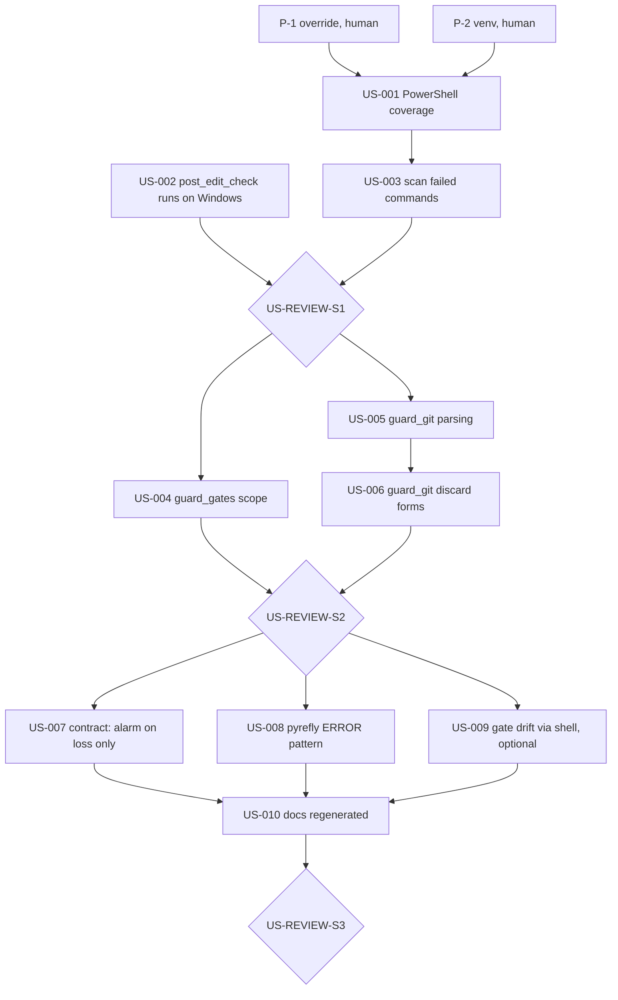

# PRD: Harness Hardening

## Introduction

The probes on 2026-10-09 found that the CI gates hold, but several in-turn hooks do not.
On this Windows machine the in-turn layer that `docs/GUARDRAILS.md` describes is partly not running,
and partly has holes. Every finding below came from a command that was run, and each is restated as
an acceptance criterion. The probe scripts and their BEFORE output are in
`docs/evidence/harness_probes_2026-10-09.md`; copy a script out of it to re-run a matrix.

### Baseline (VERIFIED, 2026-10-09, scratch venv, Python 3.14.3)

| Gate | Command | Result |
| --- | --- | --- |
| ruff | `ruff check .` | All checks passed |
| types | `python -m tools.check_types` (with `VIRTUAL_ENV` set) | 0 diagnostics (4 suppressed); hooks 0 |
| check_fp | `python -m tools.check_fp` | 0 finding(s) |
| pytest | `pytest -q` | 215 passed |
| mutation | `python -m tools.mutation_check` | 21 of 21 killed, canary survived |
| RED audit | `check_red --base 2b68ad6^ --head 2b68ad6` | 37 of 37 RED |

### Findings this PRD fixes (VERIFIED by probe unless marked)

| ID | Finding | Evidence |
| --- | --- | --- |
| F1 | The `PowerShell` tool bypasses every shell hook: matchers say `Bash` only. | `git add -A --dry-run` denied in Bash, exit 0 in PowerShell; `WARN`/`Traceback` lines from PowerShell not scanned |
| F2 | `post_edit_check` cannot start on Windows: wired to `.venv/bin/python`; no `.venv` exists, and on Windows it would be `.venv/Scripts/python.exe`. | wired command: `exit=127 ... No such file or directory` |
| F3 | With a venv, `post_edit_check` and `check_types` report false `missing-import` ERRORs, because pyrefly queries the first Python on PATH, not `sys.executable`. | `post_edit_check` on clean `app/services.py`: exit 2, 3 bogus ERRORs; with `--python-interpreter-path <sys.executable>`: `0 errors` |
| F4 | `diagnostic_scan` never sees a failed command: a non-zero exit does not fire `PostToolUse`. The docs (as relayed) say it fires both; the live trace says it does not. | `.fired.log`: exit 0 command logged, exit 3 command not logged |
| F5 | `guard_git` misses discard and stage-all forms, and has one false positive. | 17 of 29 (round 1) and 9 of 20 (round 2) probe cases mismatched; the table is in US-005/US-006 |
| F6 | `guard_gates` misses gate files, case variants and NotebookEdit. | 11 of 20 probe paths mismatched; the table is in US-004 |
| F7 | `diagnostic_scan`'s payload-contract check raises a false "SHAPE MOVED" alarm whenever the harness adds a key. | 6 false alarms in one session: `persistedOutputPath`, `persistedOutputSize`, `backgroundTaskId`, `backgroundCwdHint`, `bashEditDiff` |
| F8 | `diagnostic_scan` matches pyrefly `WARN` but not pyrefly `ERROR`. | 40+ `ERROR ...` lines in one output, 0 hits |
| F9 | The docs are stale: 17 mutants and 174 tests stated; 21 and 215 now. The guard commit says 35 tests; it added 37. | `mutation_check`, `pytest -q`, `check_red` outputs above |

### Not findings: measured and good, keep as is

- Precision of `diagnostic_scan` patterns on green gate output: **0 hits** on pytest -v (226 lines), ruff, check_fp, check_types, complexity, git log.
- `cat` of source trips the scanner in **3 of 48** files, all of which are about diagnostics. Accepted; do not add read-only-command suppression.
- PreToolUse `deny` is enforced under `--dangerously-skip-permissions` (documented). The ralph loop is therefore still governed by `guard_gates`.

## Goals

1. Every shell route an agent has (Bash, PowerShell) is judged by the same shell hooks.
2. The in-turn type/lint check runs on Windows and on POSIX, and is silent on a clean file.
3. Failed commands are scanned for diagnostics, not only successful ones.
4. `guard_git` and `guard_gates` refuse every case in their probe tables, and stay quiet on every allowed case.
5. Each fix is LOCKed: a test that was RED first, plus a mutant the suite kills.
6. The docs' numbers are regenerated from commands, not edited by hand.

## Contract (per the global engineering standards)

- **Oracle:** the probe tables in each task, written before the code as parametrized tests. Each new test must be RED on `main` (`check_red`), and each fix gets a mutant (`mutation_check`). For the live-only behaviours (F1, F4), the oracle is a recorded live firing, never the documentation.
- **Scope boundary (NOT in this change):** app code; CI workflow structure; porting `check_claims`/`check_discipline` from ssi; a full shell parser; protecting `tests/` from the agent; Bash-route writes to gate files (detected by an optional task, never blocked).
- **Failure mode:** a hook that crashes, or matches too broadly. A PreToolUse crash is non-blocking, so it fails open. A false deny stalls the agent, and a person notices the deny reason in the transcript. Every hook keeps its exit-0 contract, and the allowed-case tables exist to catch over-matching.
- **Rollback:** each task is one commit on branch `harness-hardening`. Revert that commit. Gate files return to `main` with `git checkout main -- <path>` (run by a person).

## The gate-edit problem (decision required before the loop)

Most fixes edit gate files (`.claude/hooks/*`, `.claude/settings.json`, `tools/mutation_check.py`).
`guard_gates` refuses those edits by design, also under `--dangerously-skip-permissions`.
The route around it, writing the files through Bash, is the exact bypass this PRD documents, so the loop must not use it.

| Option | How | Cost |
| --- | --- | --- |
| **A. Launch-time override (recommended)** | P-1: a person adds to `guard_gates` that, when the hook process env has `GATE_EDIT=1`, gate edits are allowed and each one is announced through `additionalContext`. A person launches the loop with `GATE_EDIT=1 ./ralph.sh ...`. Hooks inherit Claude Code's process env, and a variable exported inside a Bash tool call does not reach later hooks (documented). The `env` key in `settings.local.json` is closed by gating that file in P-1. | One human patch. Inside the loop, gates are writable; the backstops are RED-first, the mutants and human review of the branch diff. |
| B. Patch-out | The loop writes RED tests plus `patches/US-xxx.diff` for gate files. A person runs `git apply` between iterations. | No unattended loop; one manual step per task. |
| C. Disable hooks for the loop | — | Rejected: the loop would run with none of the guards it is fixing. |

## Prerequisites (a person, before the loop; not loop tasks)

**P-1 (Option A only) Gate-edit override and `settings.local.json`.** A person applies this to `.claude/hooks/guard_gates.py`:
- Add `(".claude", "settings.local.json")` to `GATES`.
- In `main()`, after a refusal has been decided: if `os.environ.get("GATE_EDIT") == "1"`, print an allow with `additionalContext`: `"gate edit to <path> allowed by GATE_EDIT=1 set at launch"`. Otherwise deny as today.
- Add a test to `tests/integration/test_hooks.py`: the override env allows a gate edit, absent env denies, and `GATE_EDIT=0` denies.

**P-2 Environment.**
```bash
python -m venv .venv
.venv/Scripts/python -m pip install -e ".[dev]"     # POSIX: .venv/bin/python
```
Run the baseline gates. Every one must match the Baseline table before US-001 starts.

### How to run

```bash
GATE_EDIT=1 ./ralph.sh harness_hardening 20 2 sonnet     # from the repo root, on branch harness-hardening
```
`ralph.sh` lives in `C:/dev/libesrm0/libesrm0/`; copy it or call it by path. It reads `PRD_HARNESS_HARDENING.md` and `progress_harness_hardening.txt`.

**In-session alternative:** the same tasks, run in order by the assistant in a Claude Code session started with `GATE_EDIT=1`. Without that, every gate edit is shown as a diff and needs a person's approval.

## Task Summary

- **Total:** 10 build tasks + 3 review gates = 13
- **Progress:** 0/13 complete (0%)
- **Status:** Not started
- **Next Task:** US-001

## Task Dependencies



## Rules for every task

- **RED first.** Write the test, run it, and paste the failing output into the progress file. Only then change code. `python -m tools.check_red --base main` must pass before the task is marked `[x]`.
- **Portable RED.** CI runs on Linux. A Windows behaviour is tested through a pure function with an explicit input (e.g. `os_name="nt"`), never by depending on the host OS, so the test is RED on `main` on Linux too.
- **LOCK.** Every fix adds a `Mutant` to `tools/mutation_check.py` that reverts the essence of the fix. `python -m tools.mutation_check` must say `N of N mutants killed`.
- **Full gate run before `[x]`:** `ruff check .`, `python -m tools.check_types`, `python -m tools.check_fp`, `pytest -q`, `python -m tools.check_red --base main`, `python -m tools.mutation_check`. Paste the summary lines.
- **Never** write a gate file through Bash or PowerShell (`>`, `sed -i`, `Set-Content`, a Python one-liner). If the Edit tool is refused, stop and record it in the progress file.
- **Never** `git add -A` / `.`: stage named paths.
- Hooks keep their exit contract. PreToolUse exits 0 and decides through JSON. `diagnostic_scan` never blocks.

---

## Sprint 1: Make the hooks actually run (~45 min)
**Status:** NOT STARTED

- [ ] **US-001** Shell hooks cover PowerShell (~15 min, ~60 lines) [depends: P-1, P-2]
- [ ] **US-002** post_edit_check runs on Windows and POSIX, and is silent on a clean file (~20 min, ~80 lines) [depends: P-2]
- [ ] **US-003** diagnostic_scan also scans failed commands (~15 min, ~70 lines) [depends: US-001]
- [ ] **US-REVIEW-S1** Sprint 1 Review 🚧 GATE (~5 min) [depends: US-002, US-003]

### US-001: Shell hooks cover PowerShell (~15 min, ~60 lines)

**Implementation:**
- `.claude/settings.json`: change the `guard_git` PreToolUse matcher and the `diagnostic_scan` PostToolUse matcher from `Bash` to `Bash|PowerShell`. A matcher made only of letters and `|` is an exact-list match, per the hooks docs.
- `guard_gates` PreToolUse matcher: `Write|Edit|MultiEdit|NotebookEdit`. In `guard_gates.main()`, accept `NotebookEdit` and read `tool_input.notebook_path` when `file_path` is absent.
- New test `tests/integration/test_settings.py`:
  - Load `.claude/settings.json`. For each hook whose script is `guard_git.py` or `diagnostic_scan.py`, the matcher split on `|` must contain both `Bash` and `PowerShell`.
  - For `guard_gates.py`, it must contain `NotebookEdit`.
- Add to `tests/integration/test_hooks.py`: a `PowerShell` payload `{"tool_name":"PowerShell","tool_input":{"command":"git add -A"}}` is denied by `guard_git`, and a `NotebookEdit` payload on `.claude/hooks/x.ipynb` is denied by `guard_gates`.
- Mutants: `shell-hooks-skip-powershell` (`"Bash|PowerShell"` → `"Bash"`, first occurrence) and `gate-hook-skips-notebooks`.

**Do NOT:** change what `guard_git` judges; that is US-005/US-006.

**Acceptance Criteria:**
- `pytest tests/integration/test_settings.py -q` was RED on `main` (pasted), green now.
- **Live:** in a new session, the PowerShell tool runs `git add -A --dry-run` and the call is denied with the `guard_git` reason. `Write-Output "WARN live-probe"` returns `additionalContext` naming `a tool logged a warning`. Paste both.
- **Live:** with `.claude/hooks/.fired.log` touched, one PowerShell call logs `fired tool=PowerShell`. Record the PowerShell `tool_input` keys seen in the progress file. Delete the log after.
- Mutation check: all killed.

### US-002: post_edit_check runs on Windows and POSIX, silent on a clean file (~20 min, ~80 lines)

**Implementation:**
- `.claude/settings.json`: the PostToolUse edit hook command becomes `python3 "$CLAUDE_PROJECT_DIR/.claude/hooks/post_edit_check.py"`, the same launcher as the other hooks.
- `post_edit_check.py`:
  - Add a pure `venv_python(root: Path, os_name: str) -> Path`. It returns `root/.venv/Scripts/python.exe` when `os_name == "nt"`, else `root/.venv/bin/python`.
  - `_run` uses that interpreter instead of `sys.executable`.
  - If the interpreter does not exist, exit 2 with: `in-turn checks are NOT running: no venv at <path>. Create it (PRD P-2).` The agent must see that the layer is off, not get silence.
- Pass `--python-interpreter-path <venv python>` to pyrefly in `post_edit_check`. Pass `--python-interpreter-path sys.executable` in `tools/check_types.py`'s `PYREFLY` tuple.
- Tests in `tests/integration/test_hooks.py`:
  - `venv_python(Path("r"), "nt")` and `venv_python(Path("r"), "posix")` return the two paths.
  - `findings()` on clean `app/services.py`, run in a subprocess whose env has `VIRTUAL_ENV` removed and `PATH` set to an empty temp dir, returns `[]`. On `main` this returns `missing-import` ERRORs (or ruff cannot run). Confirm it is RED on `main` and paste the output.
  - With no venv, the hook exits 2 and names the path.
- Mutants: `post-edit-drops-interpreter-path` and `check-types-drops-interpreter-path`.

**Acceptance Criteria:**
- The clean-file test is RED on `main`, green now. If it is not RED on `main` on Linux, stop and record why: the oracle is wrong.
- **Live:** edit a scratch `.py` file in the repo with a deliberate `x: int = "s"`. The `post_edit_check` finding comes back in the same turn. Then fix the file and see no finding.
- `python -m tools.check_types` passes with `VIRTUAL_ENV` unset.
- Mutation check: all killed.

### US-003: diagnostic_scan also scans failed commands (~15 min, ~70 lines)

**Implementation:**
- **Step 1, record before you code:** register `diagnostic_scan.py` under `PostToolUseFailure` with matcher `Bash|PowerShell` in `settings.json`. Run one failing command (`echo "WARN x"; exit 3`). With `.fired.log` armed, have the hook dump the payload's key names (never values) into `.claude/hooks/payload_contract_failure.json`, the same way `record_contract` does.
- Step 2: `extract_output()` reads whatever field that recorded payload actually carries the output in. The docs say `error`; trust the recording. Tests are built from the recorded shape, as `test_diagnostic_scan.py` already does for the success payload.
- `render()` says `the command FAILED (exit n)` when the event is `PostToolUseFailure`.
- Mutant: `scan-ignores-failed-commands` (the failure-field read removed).

**Acceptance Criteria:**
- **Live:** `echo "WARN live"; exit 3` in Bash and `Write-Output "WARN live"; exit 3` in PowerShell both return `additionalContext` naming the WARN line. Paste both.
- Tests built from `payload_contract_failure.json` were RED on `main`.
- Mutation check: all killed.

### US-REVIEW-S1: Sprint 1 Review 🚧 GATE (~5 min)

**Scope:** US-001 to US-003
**Review Steps:**
1. Full gate run (see Rules), pasted.
2. Re-run `probe_scan` (precision): 0 hits on green gate output. A new event or matcher must not add noise.
3. Read `settings.json`: every hook entry names an interpreter that exists on both OSes.

**Gate:** Output `<review-passed/>` or `<review-issues-found/>` with a list. Commit `"docs: US-REVIEW-S1 complete"`.

---

## Sprint 2: Make the guards judge the right things (~60 min)
**Status:** NOT STARTED

- [ ] **US-004** guard_gates: missing gates, case variants (~15 min, ~50 lines) [depends: US-REVIEW-S1]
- [ ] **US-005** guard_git: find git inside wrappers, global options, PowerShell syntax (~25 min, ~120 lines) [depends: US-REVIEW-S1]
- [ ] **US-006** guard_git: every discard form, cwd drift, aliases, `--staged` false positive (~25 min, ~120 lines) [depends: US-005]
- [ ] **US-REVIEW-S2** Sprint 2 Review 🚧 GATE (~5 min) [depends: US-004, US-006]

### US-004: guard_gates scope (~15 min, ~50 lines)

**Probe table → parametrized test (`edit_allowed(path)`):**

| Path | Want |
| --- | --- |
| `.claude/settings.local.json` | deny (already done in P-1; keep the test) |
| `tools/check_red.py`, `tools/check_fp.py`, `tools/check_types.py`, `tools/isolation.py` | deny |
| `tests/conftest.py` (it enforces the control-test reason) | deny |
| `pyproject.toml` (pytest config: `testpaths`, `addopts`) | deny |
| `.Claude/Hooks/guard_git.py`, `RUFF.TOML`, `Tools/Mutation_Check.py` | deny |
| `app/services.py`, `tests/unit/test_rules.py`, `tests/spec.py` | allow |

**Implementation:**
- Add the entries to `GATES`.
- Match on `casefold()`ed parts. On Linux this also refuses a new file named `RUFF.TOML`; that is accepted.
- Mutants: `gates-case-sensitive` and `gates-forget-check-red`.

**Decision recorded:** `tests/spec.py` stays editable. Tests are the agent's job, and a spec change shows in review. Revisit if a person says otherwise.

**Acceptance Criteria:** every row passes; the allow rows were already green on `main`, the deny rows RED; mutation check all killed.

### US-005: guard_git parsing (~25 min, ~120 lines)

**Probe table → parametrized test (driven through `run_hook("guard_git", ...)` against a temp repo with a dirty file, as `probe_git.py` did):**

| Command | Want |
| --- | --- |
| `git -C . add -A`, `git -c core.x=1 add -A`, `git --no-pager add -A` | deny |
| `git.exe add -A` | deny |
| `git add -Av`, `git add -uv` | deny |
| `git add :/`, `git add -- :/`, `git add ':(top)'` | deny |
| `bash -c "git add -A"`, `sh -c 'git checkout -- f.txt'` (f.txt dirty) | deny |
| `env git add -A`, `& git add -A`, `cmd /c git add -A` | deny |
| `pwsh -Command "git add -A"`, `powershell -c "git add -A"` | deny |
| ``git add ` (newline) -A`` (PowerShell continuation) | deny |
| `$(git add -A)` | deny |
| `git commit -m 'mention git add -A here'`, `grep -E "a\|b" f.txt` | allow |
| `git status`, `git checkout main`, `git add f.txt`, `git log -- .`, `git diff -- sub` | allow |

**Implementation:**
- `words()` normalises `git.exe` → `git`, and skips git's global options (`-C <x>`, `-c <x>`, `--git-dir=…`, `--work-tree=…`, `--no-pager`, `-P`, `--paginate`) to find the subcommand.
- Unwrap known prefixes: `env [VAR=x…]`, `&`, `command`, `exec`, `cmd /c`.
- For `bash|sh|pwsh|powershell -c|-Command "<s>"`, judge `<s>` recursively.
- Treat `$( … )` bodies as commands.
- In `guard_shared.commands()`, join PowerShell backtick-newline continuations before splitting.
- In `check_add`: deny any short-flag cluster containing `A` or `u`, and any pathspec that starts with `:/` or `:(top`.
- **Stated limit, in the docstring:** `eval`, scripts, `Start-Process git -ArgumentList …` and aliases defined outside the repo are not parsed. Note that `Start-Process` was allowed in the probe.
- Mutants: `git-hook-ignores-global-options` and `git-hook-ignores-nested-shell`.

**Acceptance Criteria:** every row passes; every allow row stays allowed; mutation check all killed.

### US-006: guard_git discard forms (~25 min, ~120 lines)

**Probe table** (temp repo; `sub/x.txt` dirty unless stated):

| Command | Want |
| --- | --- |
| `git checkout sub/x.txt`, `git checkout .`, `git checkout HEAD sub/x.txt` (no `--`) | deny |
| `git checkout -f`, `git checkout --force main`, `git switch --discard-changes main`, `git switch -f main` | deny |
| `git reset --hard`, `git reset --hard HEAD~1` | deny |
| `git clean -fd`, `git clean -fdx` (with an untracked file present) | deny |
| `git stash drop`, `git stash clear` | deny |
| `cd sub && git checkout -- x.txt`, `cd sub && git restore x.txt` | deny (judged in `sub`) |
| `git aa` where repo config has `alias.aa = add -A` | deny |
| `git restore --staged sub/x.txt` | **allow** (index only; today a false deny) |
| `git checkout main`, `git checkout -b new`, `git switch main` (clean tree) | allow |
| `git reset --hard` / `git clean -fd` on a clean tree with no untracked files | allow |
| `git checkout -- f.txt` where f.txt is clean | allow |

**Implementation:**
- `checkout` without `--`: after options, an argument that exists as a path in the effective cwd (or is `.`) puts the command in path mode. When the first argument verifies as a ref (`git rev-parse --verify --quiet`) and later arguments are paths, that is path mode too.
- Force forms (`checkout -f/--force`, `switch --discard-changes/-f`, `reset --hard`, `stash drop/clear`): deny when `git status --porcelain` is non-empty.
- `clean -f…`: deny when `git status --porcelain --untracked-files=all` lists `??` entries.
- Fail closed, as today, when `git status` cannot run.
- `restore --staged` without `--worktree`/`-W`: allow.
- Track `cd <dir>` across a compound line: a `cd` command updates the cwd used for later commands in the same line.
- Expand a repo-local alias once: `git config --get alias.<name>`.
- Mutants: `git-hook-allows-checkout-without-dashdash` and `git-hook-allows-reset-hard`.

**Acceptance Criteria:** every row passes; the false-positive row was RED on `main`; mutation check all killed.

### US-REVIEW-S2: Sprint 2 Review 🚧 GATE (~5 min)

**Scope:** US-004 to US-006
**Review Steps:**
1. Full gate run, pasted.
2. Re-run both `guard_git` probe matrices and the `guard_gates` matrix: 0 mismatches. Paste the output.
3. Linus check: is `guard_git` still readable top to bottom? If it is over ~250 lines, split the parsing into `guard_shared`.

**Gate:** `<review-passed/>` or `<review-issues-found/>`. Commit `"docs: US-REVIEW-S2 complete"`.

---

## Sprint 3: Noise, recall, and the record (~50 min)
**Status:** NOT STARTED

- [ ] **US-007** Payload contract alarms only on loss (~10 min, ~40 lines) [depends: US-REVIEW-S2]
- [ ] **US-008** diagnostic_scan sees pyrefly ERROR lines (~10 min, ~20 lines) [depends: US-REVIEW-S2]
- [ ] **US-009** (OPTIONAL, needs a person's yes) Report gate files changed through a shell (~20 min, ~80 lines) [depends: US-REVIEW-S2]
- [ ] **US-010** Regenerate doc numbers; record the probes (~15 min, docs) [depends: US-007, US-008, US-009]
- [ ] **US-REVIEW-S3** Final Review 🚧 GATE (~5 min) [depends: US-010]

### US-007: Contract alarms only on loss (~10 min, ~40 lines)

**Implementation:**
- `check_contract()` reports when a pinned top-level key or a pinned `tool_response` key is **gone**, or when `tool_response` stops being a dict.
- Added keys are not reported. They were the only alarms seen live, and all of them were benign.
- Tests are parametrized over the five live extra-key sets from F7, each of which must give `[]`. A payload with `stdout` removed must still alarm.
- Mutant: `contract-alarms-on-added-keys`.

**Acceptance Criteria:** RED on `main` for the five extra-key cases; mutation check all killed. **Live:** a large-output command and a background command produce no contract note.

### US-008: pyrefly ERROR lines (~10 min, ~20 lines)

**Implementation:**
- Add the pattern `(r"(?m)^\s*ERROR\b", "a tool logged an error")` next to the `WARN` one. Cite F8 in its comment.
- Test: the 3 bogus `ERROR Cannot find module ...` lines recorded in F3 produce hits.
- Precision test: the green outputs from the Baseline (pyrefly `INFO 0 errors`, pytest -v, ruff) produce 0 hits.
- Mutant: `scan-misses-pyrefly-error`.

**Acceptance Criteria:** both tests pass; the recall test was RED on `main`; mutation check all killed.

### US-009 (OPTIONAL): Report gate files changed through a shell (~20 min, ~80 lines)

Skip and mark `[x] SKIPPED (no decision)` unless a person has approved it in `progress_harness_hardening.txt`.

**Why optional:** this is detection, not prevention. In ssi, the general version (`guard_effects`) caught 0 defects. This version watches only the gate list, where one silent edit voids a gate.

**Implementation:**
- New PostToolUse hook `gate_drift.py` on `Bash|PowerShell`. It runs `git status --porcelain -- <GATES>`. If any gate path is modified in the worktree, it returns `additionalContext`: `a gate file changed through the shell: <paths>. A gate cannot check its own weakening; a person must review this.`
- It imports `GATES` from `guard_gates` so there is one list.
- It reports and never blocks; it must finish in under 1 s.
- Mutant: `gate-drift-silent`.

**Acceptance Criteria:**
- **Live:** `echo "# x" >> ruff.toml` in Bash produces the context. Then the person restores the file with `git checkout -- ruff.toml`; `guard_git` will refuse that, by design, so the person runs it outside the agent.
- Clean-tree commands produce nothing.

### US-010: Regenerate doc numbers; record the probes (~15 min, docs)

**Implementation:**
- `docs/CHECKS.md`:
  - Replace the mutation and pytest blocks with fresh pasted output.
  - Add instrument-defect rows 13+ for F1–F8, each with the probe command and output.
  - Correct "35 tests" to the measured count.
- `docs/GUARDRAILS.md`:
  - Fix the "injects 17 bugs" sentence.
  - Hook table: matchers include PowerShell; `post_edit_check` names its interpreter rule.
  - The limit paragraph names PowerShell, plus what is still not parsed.
- `docs/evidence/harness_probes_2026-10-09.md`: append an AFTER section, with each probe re-run and its output pasted. The BEFORE section already exists.

**Do NOT:** type any number by hand. Each number is pasted from a command that appears next to it.

**Acceptance Criteria:** `grep -n "17 bugs\|174 passed\|35 tests" docs/*.md` returns nothing stale; every number has its command alongside.

### US-REVIEW-S3: Final Review 🚧 GATE (~5 min)

**Review Steps:**
1. Full gate run, pasted.
2. All probe matrices: 0 mismatches.
3. Live: the US-001 and US-003 checks, re-run in a fresh session.
4. Fresh-reviewer angle: give the diff to a reviewer agent told to find a command that destroys uncommitted work, or edits a gate, without any hook noticing. Record each hit as a new probe row, or as a stated limit.

**Gate:** `<review-passed/>` or `<review-issues-found/>`. Commit `"docs: US-REVIEW-S3 complete"`.

---

## Non-Goals

- A real shell parser for Bash or PowerShell. The guards stay table-driven, with their limits stated.
- Blocking Bash/PowerShell writes to gate files. US-009 only reports them.
- Porting ssi's `check_claims.py`, `check_discipline.py`, `PROVEN_RED` or `unreachable.py`. See the brainstorm.
- Making `tests/` read-only to the agent.

## Brainstorm: considered, not in this PRD

| Idea | Why not now |
| --- | --- |
| Port `check_claims.py` (re-run fenced claim blocks in docs) | It would have caught F9 automatically. It is the next PRD, and it needs a decision on its allowlist. |
| PROVEN_RED per test module (ssi) | Overlaps `check_red` + mutants; in ssi it costs 60% of suite time. |
| Deny `git config alias.*` writes | Narrow; US-006 expands repo-local aliases instead. |
| Hash-pin hook files and verify at SessionStart | Same detection as US-009, but later and with more machinery. |
| Suppress scans of read-only commands (`cat`, `Get-Content`) | Measured 3 of 48 files; noise too small to justify a rule (precision first, patterns only after a miss). |
| Managed-settings hooks (the only scope a project file cannot disable) | Org-level policy, outside this repo. |
| Run the mutation check in the in-turn hook | ~2-3 min per run; CI is the right place. |

## Open questions (assumption in bold, used if unanswered)

1. Gate-edit mechanism: **Option A (launch-time `GATE_EDIT=1`)**, or B, patch-out.
2. Execution: **ralph loop, unattended**, or in-session, task by task.
3. US-009 gate-drift reporter: **skip**, or build.
4. Gate `tests/spec.py`: **no**.

## Post-Build Verification

- [ ] Full gate run green locally (Windows) and in CI (Linux, both legs)
- [ ] Probe matrices: 0 mismatches
- [ ] Live: PowerShell `git add -A` denied; failed-command WARN surfaced; edit-time type error surfaced
- [ ] `mutation_check`: every mutant killed, including the ~14 new ones
- [ ] `check_red --base main`: every new test RED on `main`
